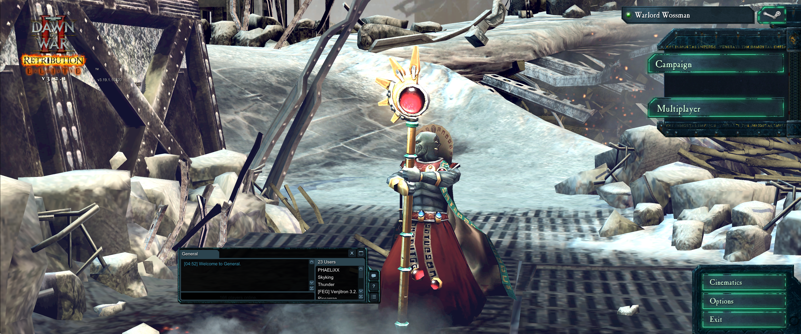
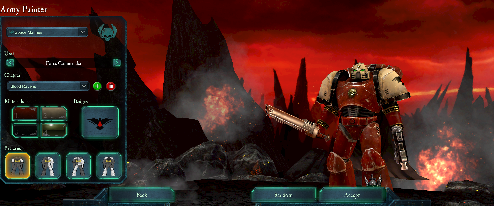
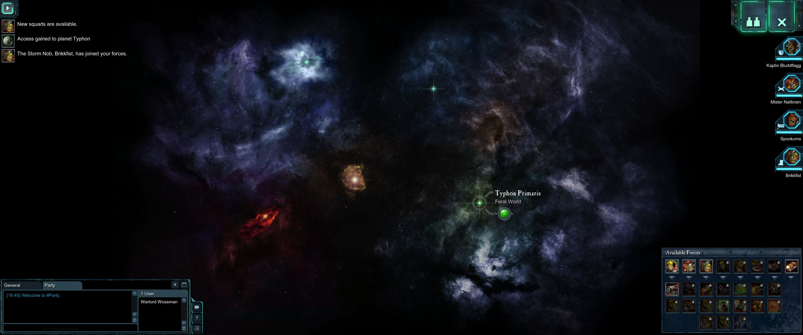
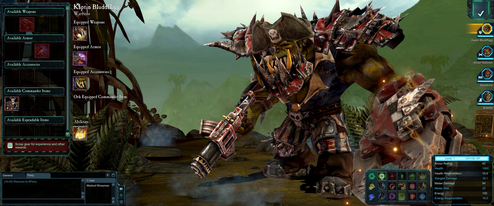

# Dawn of War II: Retribution – Ultrawide Menu Fix

On ultrawide monitors (21:9, 32:9, …), the main menu of *Warhammer 40,000: Dawn of War II – Retribution* is squeezed into a 16:9 strip with black bars on the sides. Menu buttons, your profile name and the logo get cut off by those bars. The Army Painter has the same problem: its army/unit list is pushed behind the left bar.

This small plugin removes those bars. The menus fill the whole screen, and everything that was hidden becomes visible at the screen edges.

- Fixes the main menu and the screens that share it (multiplayer lobby, match browser, post-match stats, …) and the Army Painter.
- Doesn't change matches, the in-game HUD or any other screen.
- Does nothing on 16:9, 16:10 or 4:3 monitors.
- Doesn't modify any game files. To uninstall, delete one file.

## Requirements

- The current Steam version of *Dawn of War II – Retribution*. The fix works on the retail game and should keep working as long as the game's `DOW2.exe` stays the same. If the exe ever changes, the plugin switches itself off instead of causing problems.
- **Ultimate ASI Loader** by ThirteenAG, which loads the plugin. You need the 32-bit (Win32) **`msacm32.dll`** version: download `msacm32.zip` from the [Ultimate ASI Loader releases page](https://github.com/ThirteenAG/Ultimate-ASI-Loader/releases).
  If you already use the community "DoW2 high resolution UI scaling patch", you already have this file.

## Installation

1. Find your game folder. With a default Steam install it is:
   ```
   C:\Program Files (x86)\Steam\steamapps\common\Dawn of War II - Retribution
   ```
   (In Steam: right-click the game → *Manage* → *Browse local files*.)
2. Put **`msacm32.dll`** from the Ultimate ASI Loader download into that folder, next to `DOW2.exe`.
3. Put **`DoW2_MainMenuUltrawide.asi`** from this repository's [`bin`](bin) folder into the same folder.
4. Start the game as usual.

Your game folder should now contain:
```
DOW2.exe
msacm32.dll
DoW2_MainMenuUltrawide.asi
```

**To uninstall:** delete `DoW2_MainMenuUltrawide.asi`. Also delete `msacm32.dll` if no other plugin needs it.

## Mods

The plugin works with mods as long as they don't change the menus in ways that interfere with the fix, for example by replacing the main menu's host screen with a differently built one. If a mod's menus look wrong with the plugin installed, remove the `.asi` file.

## Screenshots

Examples shown here additionally use [Elite Mod](https://www.moddb.com/mods/dawn-of-war-2-retribution-elite-mod)  
Elite Mod - 3.2.1, including its assets, logos and associated work, remains the property of its respective authors and is not covered by this project's MIT license.

Main Menu:


Army Painter:


## Screenshots Campaign (version 1.2)

Star Map:


Campaign Wargear:


## Notes

- Some antivirus tools are suspicious of small unsigned plugins that patch game memory. The full source is in [`src`](src), and [`TECHNICAL.md`](TECHNICAL.md) explains exactly what the plugin changes and how to rebuild it byte-for-byte.
- Made with [Claude](https://claude.ai) (Anthropic). The fix was found by analyzing the game's exe and menu files, and was tested in-game on a 3440×1440 monitor.

## License

[MIT](LICENSE). Ultimate ASI Loader is a separate project by ThirteenAG with its own MIT license; it isn't included in this repository.
